<p></p>

# ZoomSlidesPicker

**授業を見ながら、スライドを自動で手元に残す。**

Zoom のライブ授業や SharePoint の録画再生など、選んだ窓のスライドが変わるたびに画像を保存するデスクトップアプリ。段階表示・動画・操作バー・同じスライドへの戻りを見分け、授業の後に PNG と PDF を残す。

**Tauri v2 · React 19 · TypeScript · Rust ｜ macOS / Windows**

[ダウンロード](https://github.com/terasaki-8910/ZoomSlidesPicker-releases/releases/latest) · [アーキテクチャ](#アーキテクチャ) · [判定の流れ](#判定の流れ) · [開発](#開発)

<picture>
  <source media="(prefers-color-scheme: dark)" srcset="docs/images/hero-dark.png">
  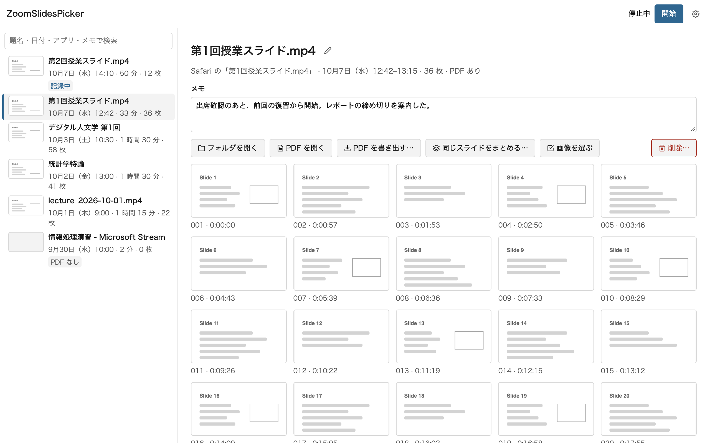
</picture>

<sub>スクリーンショットと操作デモは、実際の React 画面を既存の IPC モックで動かして撮影したもの。授業名・スライド・保存先は架空のサンプルで、実際の授業や個人情報は含まない。OS のキャプチャ処理と検出エンジンはモックの対象。</sub>

## なぜ作ったか

授業に集中しながら、スライドが替わるたびに手でスクリーンショットを撮るのは難しい。録画を見直して必要な画面を拾うのにも時間がかかる。一方、一定間隔で撮るだけでは、同じスライドや箇条書きの途中、再生中の動画ばかりが増えてしまう。

そこで、授業の窓から「残すべき状態」を選んで保存するアプリを作った。画像処理は端末内で行い、Zoom や SharePoint のアカウント連携は不要。実際の授業で見つかった、講師のカメラによる重複・操作バーの写り込み・窓を見失った後の停止などを、再現する fixture とともに改善している。

## 動いている様子

記録中のパネルから「今すぐ保存」→ 一時停止 → 再開 → 停止。保存枚数と状態が変わり、停止後は保存先を開いたり PDF を作り直したりできる。

<p>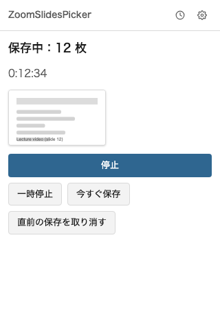</p>

<sub>操作デモは IPC モック。自動検出の仕組みは下のフロー図、検証条件は ACCEPTANCE.md を参照。</sub>

## できること

| 機能 | 振る舞い |
|---|---|
| **窓と範囲を選んで記録** | デスクトップ全体ではなく、授業の窓そのものを撮る。窓の中でスライド部分を囲み、リサイズ後も割合で追従する。別の窓が重なっても対象の中身を取得できることを macOS で確認済み |
| **必要な状態を選ぶ** | 箇条書きやペンの追記は最後の版にまとめる。鮮明化した画面を優先し、同じスライドへの戻りは画像を増やさず時刻を残す |
| **動画・カメラ・操作バーへの対処** | 動く領域による重複を抑え、動画が止まった状態を保存。操作バーが消えた版で置き換える。文書スクロールの冗長な途中位置も省く |
| **PNG と PDF を残す** | 停止時に PDF を自動作成。後から高画質・標準・軽量の 3 種類と容量の見込みを比べ、全画像または選んだ画像だけを書き出せる |
| **授業後に探して整理** | 題名・日付・アプリ名・メモで検索。名前変更、メモ、重複候補の抽出、Shift / ⌘・Ctrl の複数選択、ごみ箱への移動 |
| **常駐して操作** | メニューバー／通知領域から開始・一時停止・保存・取り消し。窓を見失ったら待機し、戻れば自動再開。手動の一時停止は勝手に再開しない |
| **動画ファイルから抽出** | mp4 / mov / m4v に同じ判定を適用。FFmpeg と ffprobe の導入が必要 |
| **設定と更新** | 日本語 / English、OS に従うライト / ダーク、保存先、比較周期、全体ショートカット。起動時と設定から更新を確認し、記録中の再起動を防ぐ |

### 範囲を決める・記録を操作する

| スライドの範囲選択 | 記録中のパネル |
|---|---|
| <picture><source media="(prefers-color-scheme: dark)" srcset="docs/images/feature-region-dark.png">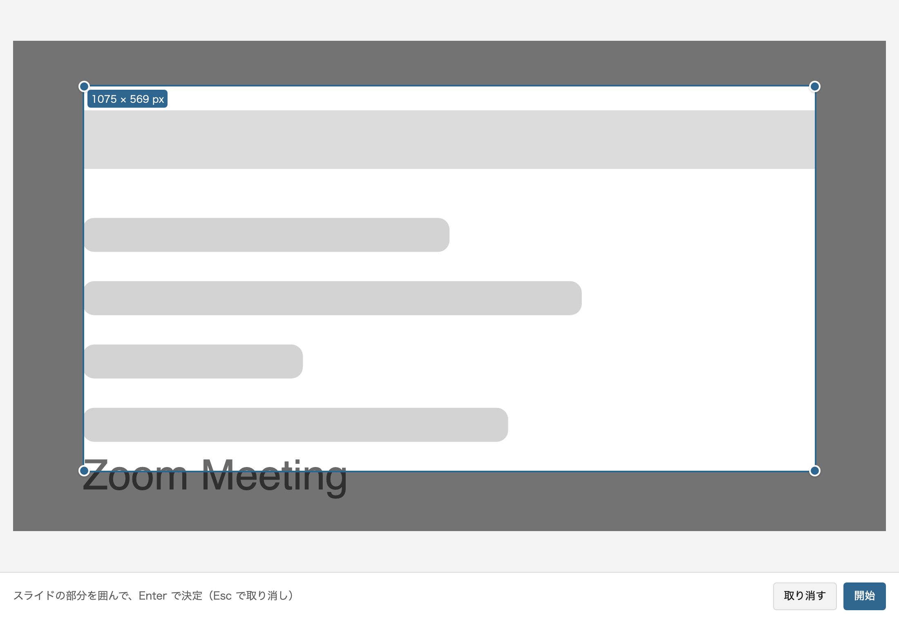</picture> | <picture><source media="(prefers-color-scheme: dark)" srcset="docs/images/feature-running-dark.png">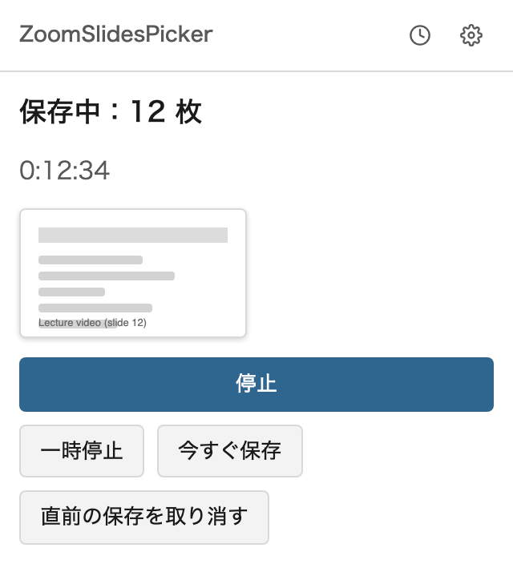</picture> |

### 授業後に整理・書き出す

<picture>
  <source media="(prefers-color-scheme: dark)" srcset="docs/images/feature-selection-dark.png">
  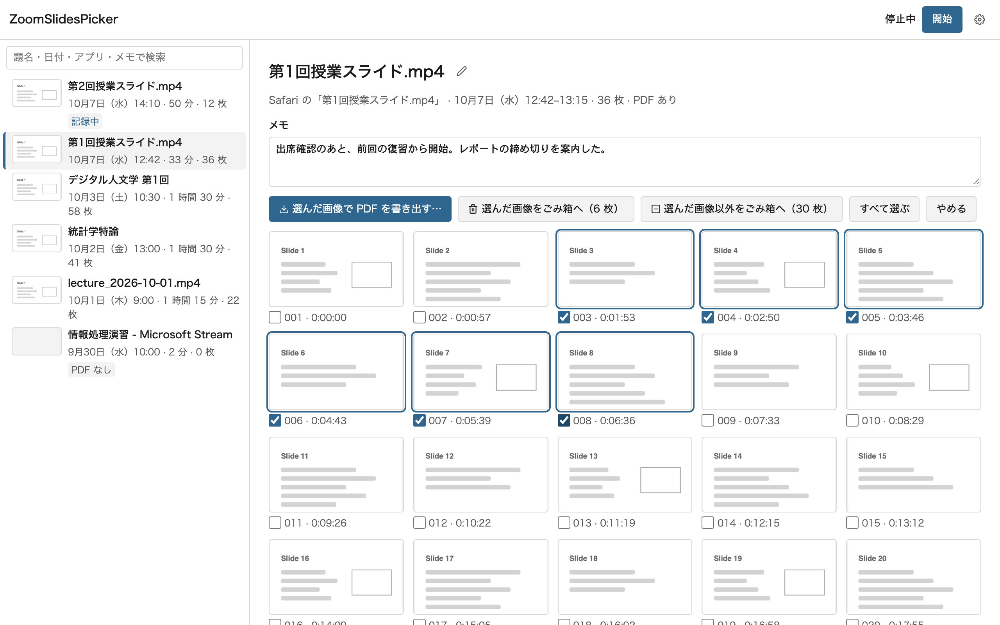
</picture>

| PDF の画質と容量を比較 | 記録ごとの操作 |
|---|---|
| <picture><source media="(prefers-color-scheme: dark)" srcset="docs/images/feature-export-dark.png">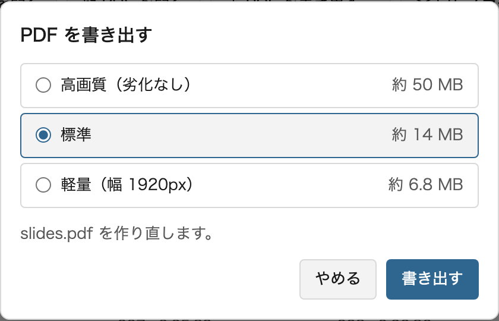</picture> | <picture><source media="(prefers-color-scheme: dark)" srcset="docs/images/feature-menu-dark.png">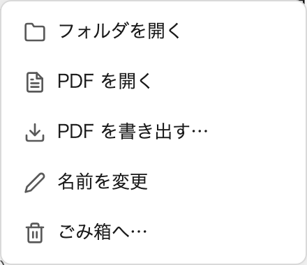</picture> |

<details>
<summary>設定画面</summary>

<sub>更新テスト用モックの仮のバージョンを表示。</sub>

<picture>
  <source media="(prefers-color-scheme: dark)" srcset="docs/images/feature-settings-dark.png">
  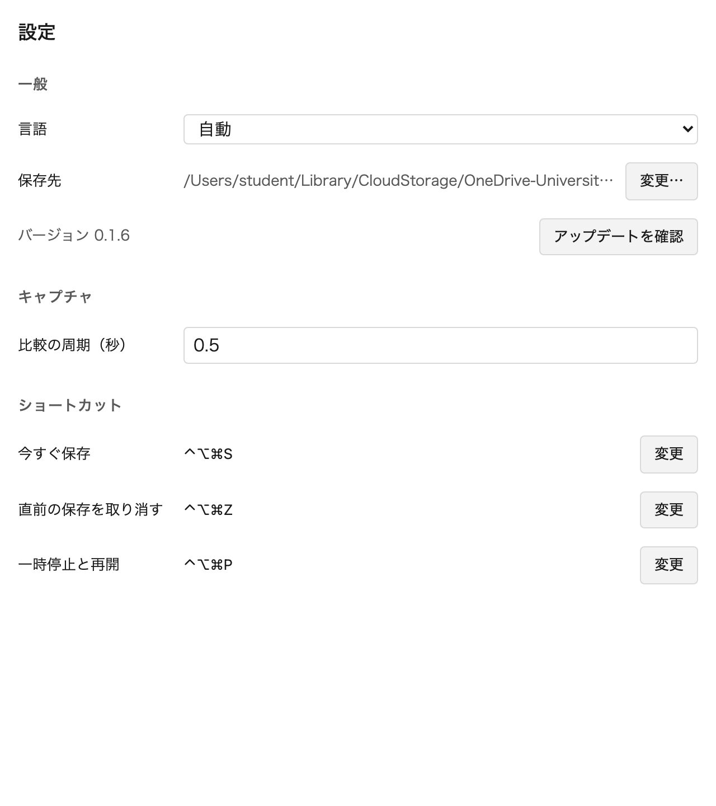
</picture>

</details>

## アーキテクチャ

<picture>
  <source media="(prefers-color-scheme: dark)" srcset="docs/images/diagram-architecture-dark.png">
  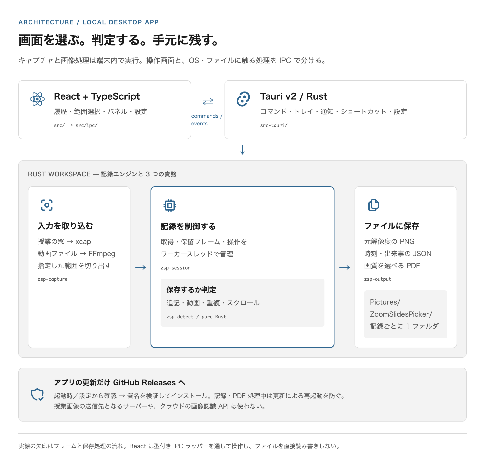
</picture>

- **判定を純粋な Rust crate にした。** `zsp-detect` は OS・I/O・UI に依存しない。同じ入力を再生して回帰を確かめられ、ライブの窓と動画ファイルで同じ判定を使える。
- **取得・判定・保存を `zsp-session` がつなぐ。** ワーカースレッドがフレームと操作を処理し、UI には状態とイベントを渡す。フル解像度の画像を授業の長さに比例してメモリにためず、保存には元解像度、比較には縮小した解析画像を使う。
- **OS とファイル操作は Rust 側に置いた。** React は型付きの IPC ラッパーを介して操作する。記録本体の `session.json` と、後から編集する名前・メモの `meta.json` も分け、記録処理と整理操作が同じファイルを上書きしない。
- **画面とエンジンを別々に検証する。** IPC モックで UI を単独起動できる。合成の授業画面で判定を再現し、実際の使用で見つかった不具合を fixture に追加する。
- **画像は端末内に保存する。** クラウドの画像認識 API や授業画像を受け取るサーバーは使わない。アプリ内更新では GitHub Releases に接続し、更新ファイルの署名を検証する。

## 判定の流れ

<picture>
  <source media="(prefers-color-scheme: dark)" srcset="docs/images/diagram-detection-flow-dark.png">
  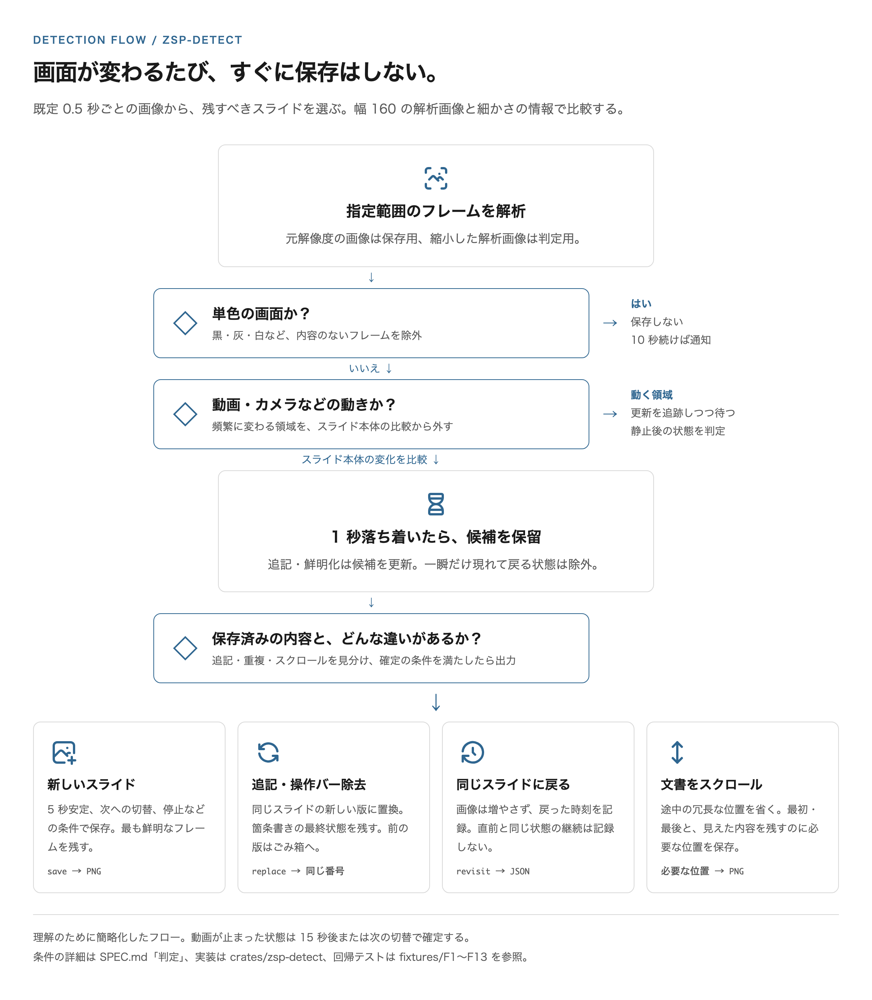
</picture>

単純な画像差分だけだと、カメラの動きやプレーヤーの操作バーまで別スライドになる。そこで「どこが動き続けるか」「文字や線が増えただけか」「以前の状態と同じか」を分けて判定する。解析は輝度を使うため、**明るさが同じで色だけが変わる変化は検出しない**。再現できる規則で処理し、不得意な変化も明示している。

判定条件の詳細は [SPEC.md](SPEC.md#判定)、実装は [crates/zsp-detect](crates/zsp-detect)、合格条件は [ACCEPTANCE.md](ACCEPTANCE.md)。

## 技術スタック

<picture>
  <source media="(prefers-color-scheme: dark)" srcset="docs/images/diagram-stack-dark.png">
  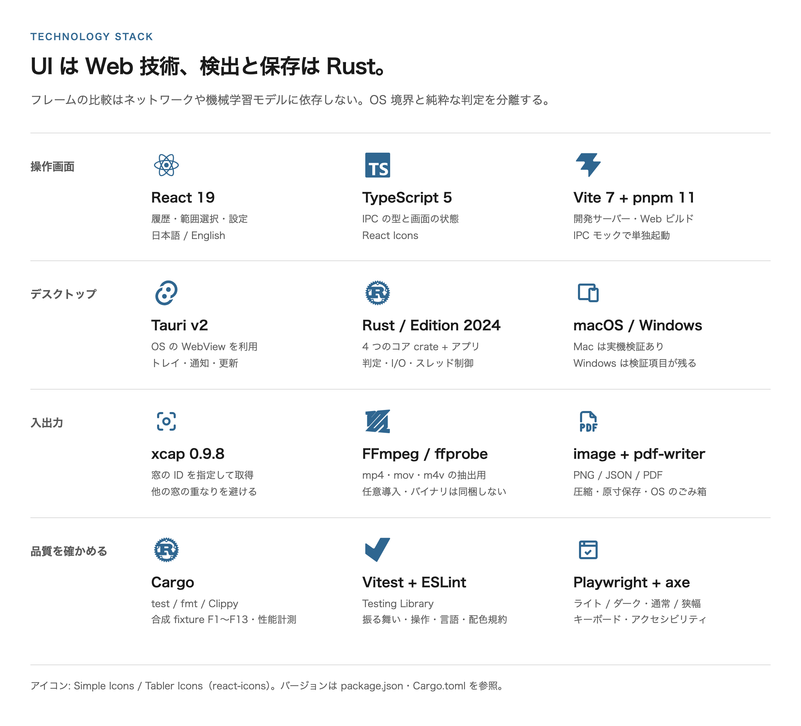
</picture>

## 使い方

1. アプリを起動し、履歴の窓または常駐パネルの「開始」から授業の窓を選ぶ。
2. スライドの部分をドラッグで囲み、Enter または「開始」。囲まずに Enter を押すと窓全体を記録する。
3. 授業中は自動で保存。必要に応じて一時停止・今すぐ保存・直前の保存の取り消しを使う。
4. 「停止」を押すと「PDF を作成中…」になり、完了を通知する。履歴から検索・整理・書き出しができる。

既定の保存先は macOS が `~/Pictures/ZoomSlidesPicker/<開始日時>/`、Windows が `%USERPROFILE%\Pictures\ZoomSlidesPicker\<開始日時>\`。設定（macOS は ⌘,、Windows は Ctrl+,）で変更できる。

```text
2026-10-17_0900/
├── 001_00-03-12.png   # 連番と、開始からの経過時間
├── 002_00-05-48.png
├── session.json      # 画像・時刻・再訪・一時停止などの出来事
├── slides.pdf        # 停止時に自動生成。標準画質が既定
└── meta.json         # 名前やメモを付けたときだけ作成
```

`session.json` の形式は [JSON Schema](docs/session.schema.json)。PNG は元解像度で保存する。PDF の高画質は劣化なし、標準は JPEG 品質 90、軽量は幅 1920px 以下・JPEG 品質 85。画像を選んで書き出すと、既存の `slides.pdf` を残したまま別の PDF を同じフォルダに作る。

### 全体ショートカット

| 操作 | macOS | Windows |
|---|---|---|
| 今すぐ保存 | ⌃⌥⌘S | Ctrl+Alt+Shift+S |
| 直前の保存を取り消す | ⌃⌥⌘Z | Ctrl+Alt+Shift+Z |
| 一時停止 / 再開 | ⌃⌥⌘P | Ctrl+Alt+Shift+P |

設定で変更できる。他のアプリを操作中でも利用できる。

## インストールと更新

[公開配布用の Releases](https://github.com/terasaki-8910/ZoomSlidesPicker-releases/releases/latest) から、macOS（Apple Silicon）の DMG または Windows（x64）のインストーラーを取得する。

0.1.7 以降は、起動時と設定の「アップデートを確認」で新版を確認できる。「今すぐ更新」「後で」「この版をスキップ」を選べる。記録・動画抽出中は更新できず、PDF 処理中は完了を待ってから更新する。0.1.6 以前からは一度だけ手動で入れ替える。

macOS では初回に「画面収録」の許可が必要。アプリの案内からシステム設定を開いて許可し、アプリを再起動する。配布ビルドは固定の自己署名を使い、Apple Developer ID による署名・公証は行っていない。「壊れているため開けません」と表示された場合は、配置後に次を実行する。

```sh
xattr -cr /Applications/ZoomSlidesPicker.app
```

## 開発

フロントエンドの検証環境は Node.js 24.19.0 / pnpm 11.12.0。Rust（Edition 2024 対応）と [Tauri v2 の開発環境](https://v2.tauri.app/start/prerequisites/) も必要。動画抽出と、その統合テストには `ffmpeg` / `ffprobe` が PATH 上に必要。fixture はコミット済みなので、通常の Rust テストに Python は不要。

```sh
pnpm install
pnpm tauri dev          # ネイティブアプリを開発用に起動
sh scripts/check.sh     # Rust / フロントエンド / UI・axe の検査
pnpm build             # TypeScript の型チェックとフロントエンドの本番ビルド
```

OS の権限や実際の保存先を使わず UI を動かす場合:

```sh
VITE_IPC_MOCK=1 pnpm dev
# http://localhost:1420/?preset=stopped#/library
# http://localhost:1420/?preset=running#/panel
# http://localhost:1420/#/region
# http://localhost:1420/#/settings
```

更新用の秘密鍵を使わないローカルビルド:

```sh
# macOS: 個人の署名証明書がない環境では signingIdentity を上書き
pnpm tauri build --config src-tauri/tauri.local.conf.json \
  --config '{"bundle":{"macOS":{"signingIdentity":"-"}}}'
```

通常の `pnpm tauri build` は更新ファイルも生成するため、リリース用の署名鍵が必要。上のコマンドは更新ファイルを生成しない確認用ビルドで、個人の自己署名証明書にも依存しない。

### 検証

| 対象 | 手段 |
|---|---|
| 判定・出力・記録制御 | `cargo test --workspace`。F1〜F13 の合成画面、画像解析・PDF・JSON Schema・窓の喪失と復帰など |
| 検出速度 | `cargo test --release -p zsp-detect --test timing`。2000×1400 のフレーム解析と判定の中央値が 20ms 以内 |
| UI の振る舞い | `pnpm test`。Vitest / Testing Library で選択・書き出し・更新・言語などを検証 |
| 実際のブラウザ描画 | `sh scripts/ui-check.sh`。IPC モック + Playwright / axe、ライト・ダーク、通常・狭幅、英語の基本動作 |
| 静的検査 | Rustfmt / Clippy、ESLint、絵文字・トークン外の色リテラルの検査 |

macOS の実機では、窓全体を他の窓で覆った状態で対象だけを撮影し、重複した戻りを保存しないことを確認済み。10 分間・2000×1400・0.5 秒周期の測定は、最大メモリ **118.6 MiB**、平均 CPU **4.56%**（2026-10-07 の開発機での個別測定。結果は [PLAN.md](PLAN.md)）。一般的な性能保証ではない。

### リポジトリ構成

| パス | 内容 |
|---|---|
| [`src/`](src) | React の各画面、日英の文言、型付き IPC とモック |
| [`src-tauri/`](src-tauri) | Tauri アプリ、OS 連携、設定、履歴、更新 |
| [`crates/zsp-capture/`](crates/zsp-capture) | xcap・動画ファイルの入力・範囲・macOS 権限 |
| [`crates/zsp-detect/`](crates/zsp-detect) | I/O に依存しない画像解析と保存判定 |
| [`crates/zsp-session/`](crates/zsp-session) | 入力・判定・保存をつなぐ記録エンジン |
| [`crates/zsp-output/`](crates/zsp-output) | PNG・JSON・PDF・ごみ箱 |
| [`fixtures/`](fixtures) / [`samples/`](samples) | 合成の授業画面、参照実装、検証スクリプト |
| [`tests/ui/`](tests/ui) | Playwright と axe の画面検証 |
| [`docs/diagrams/`](docs/diagrams) / [`docs/images/`](docs/images) | README 図の HTML/CSS と画像。再生成: `node scripts/readme-assets.mjs` |

検証用の環境変数、再生・fixture 生成、画像の再生成は [開発手順](docs/DEVELOPMENT.md)。仕様は [SPEC.md](SPEC.md)、合格条件は [ACCEPTANCE.md](ACCEPTANCE.md)、判断の理由と過去の検証は [DECISIONS.md](DECISIONS.md)。

## 既知の制約

- **Windows の実機検証が残る。** x64 インストーラーを配布しているが、現在の受入項目 D2・D5・D7 は未完了。macOS の結果を Windows の保証にはしていない。
- **キャプチャ防止・描画停止には対応できない。** 保護された授業、画面ロック・ディスプレイのスリープ中は取得できない。macOS の全画面 Zoom（別の操作スペース）と、完全に隠れた窓の継続再描画は未確認。同じ窓で別タブに切り替えると、そのタブが写るので録画は専用の窓で開く。
- **重複や不要な画面が残る場合がある。** 同じスライドでも位置・大きさが変わると別扱いになる。共有していないときの参加者画面、共有画面内の写真・動画、PowerPoint の操作ボタン、小さな講師映像の動きなどで保存が増えることがある。
- **操作バーとの境界は完全には区別しない。** マウスを動画の上に置いたままバーが消えない場合、その版が残る。範囲の端いっぱいに暗い帯を足す段階表示は、操作バーと誤認する場合がある。
- **輝度に基づく規則で判定する。** 同じ明るさの色変化は検出しない。合成の画面で条件を調整し、実際の授業で精度を検証・改善している段階。
- **コード署名と更新署名は別。** 更新ファイルの署名検証は実装済みだが、macOS の配布は Developer ID・公証なし。0.1.5 以降は固定の自己署名を使用している。

## ライセンスとアイコン

本リポジトリにはオープンソースライセンスを設定していない（Cargo の設定は `UNLICENSED`）。

UI と図版のアイコンは [React Icons](https://github.com/react-icons/react-icons) を通して利用。図版は [Simple Icons（CC0）](https://github.com/simple-icons/simple-icons/blob/develop/LICENSE.md) と [Tabler Icons（MIT）](https://github.com/tabler/tabler-icons/blob/main/LICENSE)。各ロゴは対応する技術を示すために使用している。
